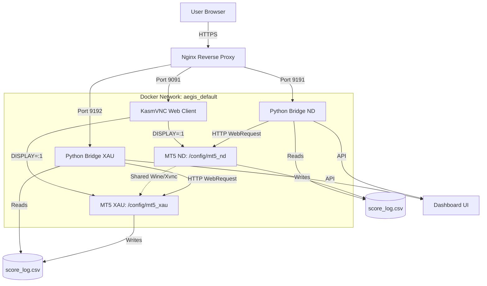

# AEGIS Network Architecture

## Overview
The AEGIS system utilizes a **Single Container, Dual Directory** architecture to maximize resource efficiency (saving ~300-500MB RAM per additional instance) while maintaining strict data isolation between trading environments (e.g., Nasdaq and XAUUSD).

## Architecture Wireframe

## Key Components
1. **Nginx Reverse Proxy**: Routes external HTTPS traffic to internal Docker ports.
2. **KasmVNC (6901 -> 9091)**: Shared X11/Wine session to conserve RAM.
3. **Isolated Directories**: /config/mt5_nd and /config/mt5_xau prevent file overwrites.
4. **Python Bridges**: Separate instances ensure data streams do not mix.

## Known Issues
- **Scan Analytics**: Currently under active troubleshooting. Data pipeline from MT5 to Bridge analytics is being investigated.

## Standard Operating Procedures (SOP)
1. **Version Sync**: Match version in #property version and Print() statements.
2. **Overwrite Method**: Bypass Wine locks by streaming content:
   cat file.mq5 | docker exec -i container sh -c 'cat > /path/to/file.mq5'
3. **Verify**: docker exec container grep "version" /path/to/file.mq5
4. **WebRequest Allowlist**: Add Bridge URL in MT5 Tools -> Options -> Expert Advisors.
